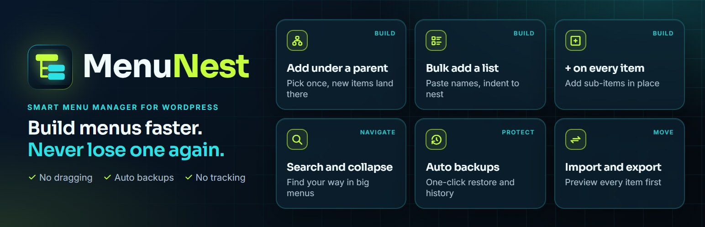
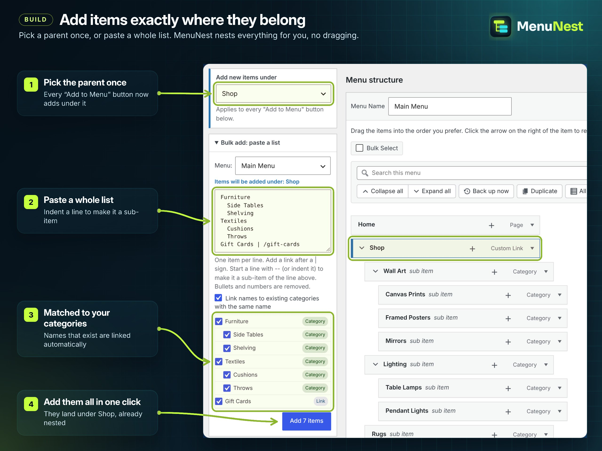
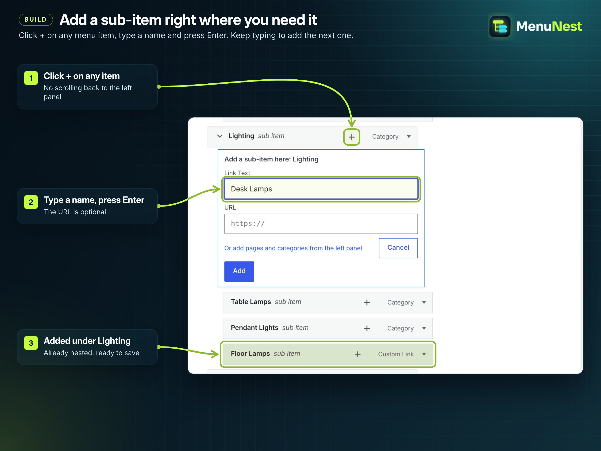
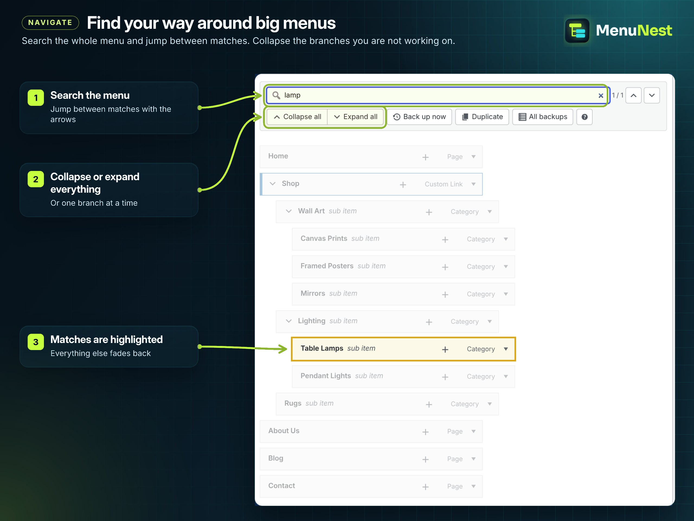
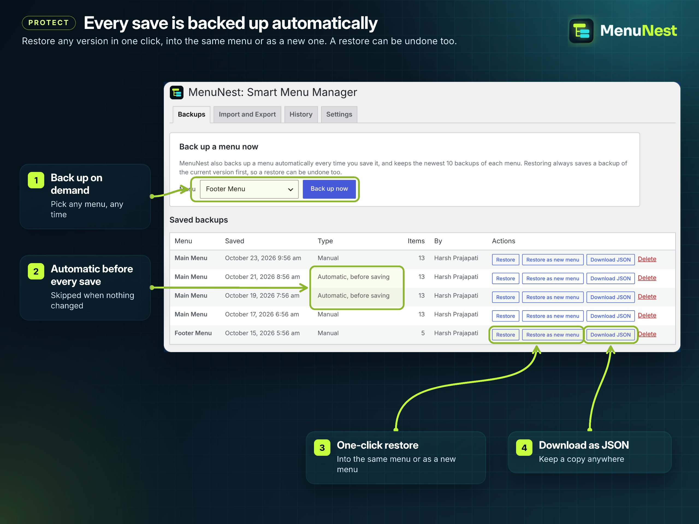
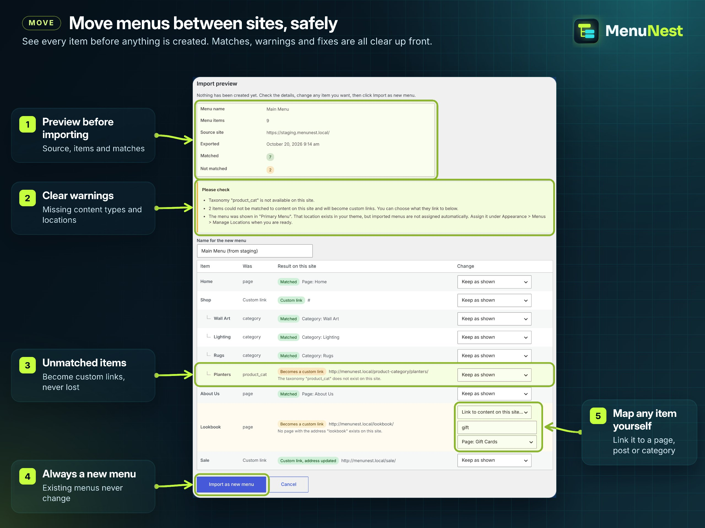
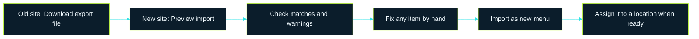
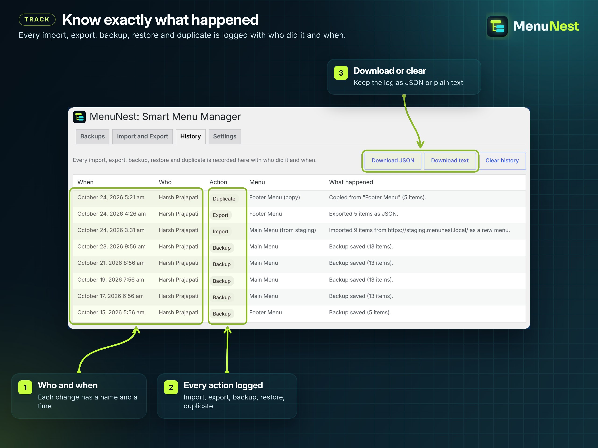

<p align="center">
  
</p>

<h1 align="center">
   MenuNest: Smart Menu Manager
</h1>

<p align="center">
  <b>Build WordPress menus without the drag-and-drop hassle, and never lose one again.</b><br>
  Add items under any parent, paste whole lists, search big menus, and back up, restore,<br>
  import and export menus with a full preview. No external services, no tracking.
</p>

<p align="center">
  <a href="https://wordpress.org/plugins/menunest-smart-menu-manager/"></a>
  <a href="https://github.com/xaviermsd/menunest-smart-menu-manager/releases/latest"></a>
</p>

<p align="center">
  <a href="https://github.com/xaviermsd/menunest-smart-menu-manager/actions/workflows/ci.yml"></a>
  
  
  
  
  
</p>

<p align="center">
  <a href="#build-menus-faster"><b>Build</b></a> ·
  <a href="#find-your-way-around-big-menus"><b>Navigate</b></a> ·
  <a href="#never-lose-a-menu"><b>Protect</b></a> ·
  <a href="#move-menus-between-sites"><b>Move</b></a> ·
  <a href="#know-what-happened"><b>Track</b></a> ·
  <a href="#install-in-a-minute">Install</a> ·
  <a href="#faq">FAQ</a> ·
  <a href="#for-developers">Developers</a>
</p>

---

## What do you want to do?

Click a task to jump straight to how it works.

| I want to... | MenuNest gives you | |
| --- | --- | --- |
| Add pages under *Shop* without dragging each one | **Add new items under** a parent you pick once | [Show me](#add-items-under-a-parent) |
| Turn a list from a doc or spreadsheet into a menu | **Bulk add**: paste, indent to nest, done | [Show me](#paste-a-whole-list) |
| Add one sub-item without scrolling back to the left panel | A **+** button on every menu item | [Show me](#add-a-sub-item-in-place) |
| Find one item in a menu with 200 entries | **Search**, highlight, jump, collapse branches | [Show me](#find-your-way-around-big-menus) |
| Undo a menu change that broke the site | **Automatic backups** and one-click restore | [Show me](#never-lose-a-menu) |
| Copy a menu from staging to live | **Export and import** with a full preview | [Show me](#move-menus-between-sites) |
| See who changed which menu, and when | A **history log** you can download | [Show me](#know-what-happened) |

> [!TIP]
> Nothing MenuNest does in the menu editor goes live until you click **Save Menu**, exactly like WordPress
> itself. Imports always create a **new** menu, and a restore always backs up the current version first.

---

## Build menus faster



### Add items under a parent

1. On **Appearance > Menus**, pick a parent in **Add new items under** (top of the left column), for example *Shop*.
2. Use any **Add to Menu** button as usual: pages, posts, custom links, categories, product categories.
3. The new items land under *Shop*, already nested. Click **Save Menu**.

Pick **Top level (no parent)** to go back to the normal behaviour. Adding a category with **all its
subcategories** works the same way: the whole tree arrives pre-nested.

### Paste a whole list

Open **Bulk add: paste a list**, choose the menu and paste. Check the preview, untick anything you don't
need, click **Add N items**, then **Save Menu**.

<details>
<summary><b>See what a pasted list turns into</b></summary>
<br>

You paste:

```text
Furniture
  Side Tables
  Shelving
Textiles
  -- Cushions
  -- Throws
Gift Cards | /gift-cards
```

MenuNest builds (with **Link names to existing categories** ticked):

```text
Shop
├── Furniture            → Category: Furniture
│   ├── Side Tables      → Category: Side Tables
│   └── Shelving         → Category: Shelving
├── Textiles             → Category: Textiles
│   ├── Cushions         → Category: Cushions
│   └── Throws           → Category: Throws
└── Gift Cards           → /gift-cards
```

</details>

<details>
<summary><b>All the list rules</b></summary>
<br>

| You write | You get |
| --- | --- |
| One item per line | One menu item per line |
| Indent with spaces or a tab, or start with `--` | A sub-item of the line above |
| `Name \| https://example.com` | A link to that address |
| `Name` with no link | A custom link to `#` |
| `- Item`, `* Item`, `1. Item`, `2) Item` | Bullets and numbers are removed |
| A name that matches a category | Linked to that category, when the box is ticked |

</details>

### Add a sub-item in place



Click **+** on any menu item, type the link text (the URL is optional) and press **Enter**. The item is
added under that parent and the field clears, so you can type the next one straight away.

---

## Find your way around big menus



- Type in **Search this menu**. Matches are highlighted; the arrows jump between them.
- **Collapse all** / **Expand all**, or the arrow on any item to fold one branch.
- **Back up now**, **Duplicate** and **All backups** live in the same toolbar.

---

## Never lose a menu



Every time you click **Save Menu**, MenuNest backs up the version you are about to replace (skipped when
nothing changed). You can also back up any menu on demand from **Appearance > MenuNest > Backups**.


<details>
<summary><b>Restore, undo and download</b></summary>
<br>

- **Restore** puts a backup back into the same menu. **Restore as new menu** creates a copy instead and
  leaves the original alone.
- The current version is always backed up before a restore, so a restore can be undone too.
- **Download JSON** saves a backup to your computer. The file can be imported on any site.
- MenuNest keeps the newest 10 backups of each menu by default (1 to 100 in Settings).

</details>

---

## Move menus between sites





<details>
<summary><b>Step by step</b></summary>
<br>

**On the old site:** go to **Appearance > MenuNest > Import and Export**, choose the menu and click
**Download export file**. Tick **Include extra item settings** to keep icons and mega menu options from your
theme and plugins.

**On the new site:**

1. Open **Import and Export**, choose the JSON file (or paste its contents) and click **Preview import**.
2. Check the summary: source site, number of items, matched and not matched.
3. Read the warnings, for example a content type that doesn't exist on this site.
4. For any item, choose **Keep as shown**, **Use a custom link** or **Link to content on this site...**
   and search for a page, post or category.
5. Name the new menu and click **Import as new menu**. Big menus import in batches with a progress bar.

</details>

<details>
<summary><b>How items are matched on the new site</b></summary>
<br>

| In the file | On the new site | Result in the preview |
| --- | --- | --- |
| A page, post or category that exists here | Same slug or path found | **Matched**, linked to the local content |
| A custom link to the old site's address | Address rewritten to this site | **Custom link, address updated** |
| Any other custom link | Kept as it is | **Custom link** |
| Content that doesn't exist here | Nothing to link to | **Becomes a custom link**, never dropped |

</details>

> [!IMPORTANT]
> Imports never change existing menus. The new menu isn't shown anywhere until you assign it under
> **Appearance > Menus > Manage Locations**.

---

## Know what happened



**Appearance > MenuNest > History** lists every import, export, backup, restore and duplicate, with the
date, the user and what happened. Download it as JSON or plain text, or clear it.

---

## Install in a minute

<table>
<tr>
<td width="50%" valign="top">

**From WordPress.org**

1. In WordPress, go to **Plugins > Add New**.
2. Search for **MenuNest**.
3. Click **Install Now**, then **Activate**.

</td>
<td width="50%" valign="top">

**From GitHub**

1. Download `menunest-smart-menu-manager.zip` from the [latest release](https://github.com/xaviermsd/menunest-smart-menu-manager/releases/latest).
2. Go to **Plugins > Add New > Upload Plugin** and choose the zip.
3. Click **Install Now**, then **Activate**.

</td>
</tr>
</table>

Then open **Appearance > Menus**. The first time, MenuNest asks you to take a backup: click
**Back up this menu now**, tick the box and click **Continue**.

**Requirements:** WordPress 6.7+, PHP 7.4+, and a theme that uses the classic menu screen
(Appearance > Menus).

## Settings

**Appearance > MenuNest > Settings**

| Setting | Default | What it does |
| --- | --- | --- |
| Backups to keep (per menu) | 10 | 1 to 100. The oldest backups are removed first. |
| Automatic backups | On | Back up a menu every time it is saved. |
| History: entries to keep | 500 | 50 to 5,000. |
| Remove data (when the plugin is deleted) | Off | When on, backups, history and settings are deleted with the plugin. Menus are never touched. |

## FAQ

<details>
<summary><b>Does it work with block themes and the Site Editor?</b></summary>
<br>
MenuNest improves the classic menu screen, Appearance > Menus, used by classic themes and by many page
builders and WooCommerce themes. Block themes edit navigation in the Site Editor instead.
</details>

<details>
<summary><b>Will it change my site by itself?</b></summary>
<br>
No. Editor changes go live only when you click Save Menu. Imports create a new menu that isn't shown
anywhere until you assign it to a location.
</details>

<details>
<summary><b>Where are backups stored?</b></summary>
<br>
In your own WordPress database, as private entries that are never shown on your site. Nothing is sent anywhere.
</details>

<details>
<summary><b>How do I undo a mistake?</b></summary>
<br>
Go to Appearance > MenuNest > Backups and click Restore on the version you want. The current version is
backed up first, so you can undo the restore too.
</details>

<details>
<summary><b>Can I import menus exported by other plugins?</b></summary>
<br>
Not in this version. MenuNest imports files exported by MenuNest (up to 5 MB).
</details>

<details>
<summary><b>What happens to my data when I delete the plugin?</b></summary>
<br>
By default, backups and history stay in the database in case you reinstall. Turn on <b>Remove data</b> in
Settings to delete them with the plugin. Your menus are never touched either way.
</details>

<details>
<summary><b>Does MenuNest phone home or track anything?</b></summary>
<br>
No. MenuNest makes no external requests and collects no data. Everything stays on your site.
</details>

---

## For developers

<details>
<summary><b>Commands</b></summary>
<br>

```bash
composer install          # PHPUnit, PHPStan, coding standards
composer lint             # WordPress Coding Standards + PHP 7.4+ compatibility
composer analyse          # PHPStan level 8
composer test             # PHPUnit with the official WordPress test suite
composer check            # all three
bash bin/build-zip.sh     # release zip in build/, without development files
```

</details>

<details>
<summary><b>Running the tests</b></summary>
<br>

The tests use the official WordPress test suite, so they need a WordPress install and a database
**that the tests are allowed to wipe**. Never use a real site.

```bash
# 1. Download WordPress for the tests.
mkdir -p /tmp/wordpress && curl -sSL https://wordpress.org/latest.tar.gz | tar -xz --strip-components=1 -C /tmp/wordpress

# 2. Create an empty database, for example "wordpress_test".

# 3. Run the tests.
WP_CORE_DIR=/tmp/wordpress WP_DB_NAME=wordpress_test WP_DB_USER=root WP_DB_PASS=secret composer test
```

All settings are in `tests/wp-tests-config.php` and can be set with environment variables
(`WP_CORE_DIR`, `WP_DB_NAME`, `WP_DB_USER`, `WP_DB_PASS`, `WP_DB_HOST`).

</details>

<details>
<summary><b>Quality gates (every push and pull request)</b></summary>
<br>

| Check | What it covers |
| --- | --- |
| PHPUnit | Backups and restore, import validation, matching and safe setting keys, batched import, history, settings, uninstall, permissions and security tokens |
| Test matrix | PHP 7.4, 8.1, 8.3, 8.4 on WordPress 6.7 and the latest release |
| PHPStan | Level 8, with WordPress-aware rules, on every PHP file |
| WordPress Coding Standards | `WordPress` ruleset, zero errors and warnings |
| PHP compatibility | PHP 7.4 and newer |
| Plugin Check | The official WordPress.org check, on the release build: no errors or warnings |

All PHP files use `declare( strict_types=1 )` and native type declarations.

</details>

<details>
<summary><b>Project layout</b></summary>
<br>

```
menunest-smart-menu-manager.php   Plugin header and loader
uninstall.php                     Removes data only when the user asked for it
includes/                         One class per job (backups, import, export, history, ...)
assets/                           Scripts and styles for the two admin screens
languages/                        Translation template
tests/                            PHPUnit tests
.wordpress-org/                   Banner, icon and screenshots for the WordPress.org listing
docs/                             Animated logo and social preview for this README
docs/brand/                       Brand sources: python docs/brand/render.py rebuilds the banners, icons and social preview
```

</details>

<details>
<summary><b>Brand colours</b></summary>
<br>

| | Colour | Used for |
| --- | --- | --- |
|  | `#061019` Navy | Backgrounds |
|  | `#c6ff3d` Lime | Main accent, the parent bar in the logo |
|  | `#2de2e6` Cyan | Second accent, the child bars in the logo |
|  | `#f2fbff` Ice | Text on dark |
|  | `#a9bdcc` Mist | Secondary text |

Headings use [Sora](https://fonts.google.com/specimen/Sora), body text uses [Inter](https://fonts.google.com/specimen/Inter).

</details>

## Contributing

Issues and pull requests are welcome. See [CONTRIBUTING.md](CONTRIBUTING.md). Security issues: see
[SECURITY.md](SECURITY.md).

## License

GPL-2.0-or-later. See [LICENSE](LICENSE).

<p align="center">
  <br>
  <sub>Made by <a href="https://profiles.wordpress.org/xaviermsd/">Harsh Prajapati</a>. Also by the same author: <a href="https://wordpress.org/plugins/fieldpilot-for-acf/">FieldPilot, AI and JSON copilot for ACF</a>.</sub>
</p>
